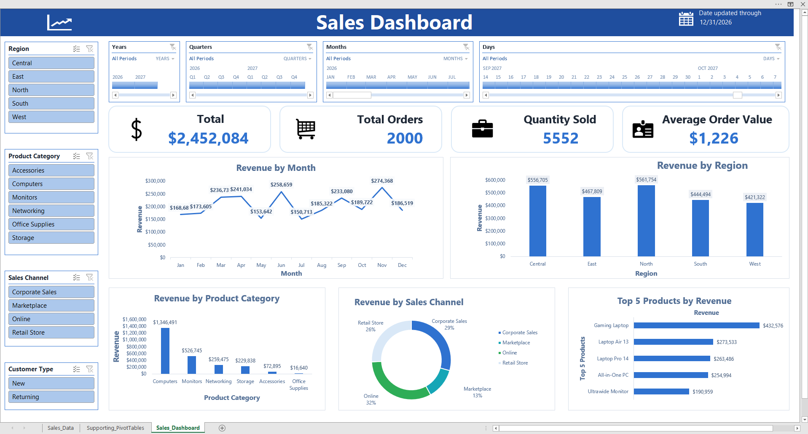
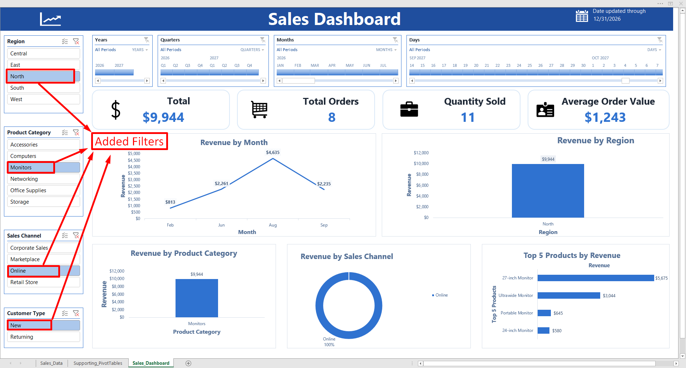

# Interactive Sales Performance Dashboard | Microsoft Excel

## Project Overview
An interactive Excel dashboard analyzing 2,000 sales records to monitor KPIs, explore revenue trends, and compare sales performance.

## Dataset
- 2,000 orders (one row per order), Jan–Dec 2026
- 12 fields: Order ID, Date, Region, Sales Channel, Customer Type, Product Category, Product, Salesperson, Quantity, Unit Price, Discount, Revenue

## Key figures (unfiltered)
| Revenue | Orders | Units | Avg order value |
|---|---|---|---|
| $2.45M | 2,000 | 5,552 | ~$1,226 |

## Business Objectives
- Monitor key sales performance indicators (KPIs).
- Analyze monthly revenue trends.
- Compare revenue across regions, product categories, and sales channels.
- Identify the top five products by revenue.
- Enable interactive, time-based sales analysis.

## Dashboard Features
- **KPI Reporting:** Total Revenue, Total Orders, Quantity Sold, and Average Order Value.
- **Trend Analysis:** Monthly revenue line chart.
- **Regional Analysis:** Revenue by region.
- **Category Analysis:** Revenue by product category.
- **Channel and Product Analysis:** Sales channel contribution and top five products by revenue.

## Development Process
1. Reviewed data completeness, date formats, numeric fields, and categorical consistency.
2. Converted the source dataset into an Excel Table.
3. Created nine PivotTables using aggregation, date grouping, and value filtering.
4. Developed PivotCharts and connected slicers and timelines for interactive analysis.
5. Designed KPI cards, applied custom number formats, formatted charts, and protected the dashboard worksheet.

## Tools & Skills
- **Excel:** Tables, PivotTables, PivotCharts, Slicers, Timelines
- **Data Analysis:** Sales Performance Analysis, KPI Reporting, Data Quality Checks
- **Data Visualization:** Interactive Dashboards, Chart Formatting, Custom Number Formatting

## Project Files
- `Interactive_Sales_Performance_Dashboard.xlsx` — Excel workbook.
- `dashboard-preview.png` — Dashboard screenshot.
- `dashboard-preview-added-filters.png` — Dashboard screenshot.
